  

  
  
  

I'm a tech lead and full-stack developer from Kyiv. I build ERP and CRM systems for manufacturing and B2B companies and take them all the way: from the first specification to the production server. After hours I make my own mobile games in native Swift and Kotlin.

Most of my work is client code under NDA, so the repositories are private. The contribution graph below counts that work too.

## What I do

<table>
  <tr>
    <th width="33%">Lead</th>
    <th width="33%">Build</th>
    <th width="33%">Ship</th>
  </tr>
  <tr>
    <td valign="top">
      Architecture and technical specifications 
      Code and migration review before every release 
      QA gate, demos, reporting to PMs and clients 
      AI-assisted workflows behind review and test gates
    </td>
    <td valign="top">
      ERP/CRM modules: sales, production, warehouse, procurement, payments 
      Data migration from Bitrix24 and 1C 
      Integrations: telephony, mail, Telegram, LLM APIs 
      Native iOS and Android apps
    </td>
    <td valign="top">
      Linux servers, Docker Compose, Caddy 
      Releases through staging to production 
      CI/CD on GitHub Actions with rollback 
      Backups, restore and incident response
    </td>
  </tr>
</table>

## A few numbers

- **6** ERP/CRM systems where I lead engineering
- **250,000+** CRM records migrated and reconciled against the source
- **600 to 3,800+** automated tests on one system
- **90%** smaller JavaScript bundle and a dashboard that loads **3x** faster

## Side projects: four mobile games

I build them in parallel under my own label, CHE.tech. Each game has two native apps, SwiftUI and Jetpack Compose, that share one set of rules and are checked against the same test vectors.

| Game | Genre | Under the hood |
| --- | --- | --- |
| **Durak Elite** | Online multiplayer card game | iOS/Android cross-play, Fastify and WebSocket backend on AWS |
| **Road Home** | Story-driven match-3 | Deterministic engines in Swift and Kotlin, 600 levels, 1,500+ automated tests |
| **Potion Bottles** | Bottle-sort puzzle | Twin engines with bit-identical results, level generator with a solver |
| **Soft Stories** | Interactive visual novel | Own script format with hand-written parsers in Kotlin and Swift |

## Tech stack

  

  Also: TanStack Query/Router/Start · Zod · PostgREST · pgvector · Caddy · MinIO · SwiftUI · SpriteKit · Jetpack Compose · StoreKit 2 · Play Billing · Vitest · pytest · XCTest · Claude Code

## Activity

  

  

  <picture>
    <source media="(prefers-color-scheme: dark)" srcset="https://raw.githubusercontent.com/vitalii-cherukha/vitalii-cherukha/output/github-contribution-grid-snake-dark.svg" />
    
  </picture>

## Journey

`2020` Project manager, construction projects &nbsp;→&nbsp; `2022` Armed Forces of Ukraine, unit commander &nbsp;→&nbsp; `2025` Full-stack developer &nbsp;→&nbsp; `2026` Tech lead, ERP and CRM systems
